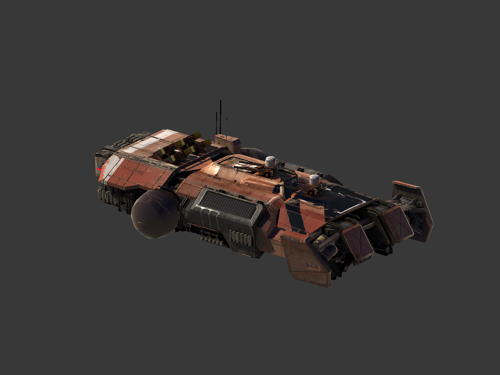

# DoK_MR

**Deserts of Kharak Modding Research**

> **This project is AI-generated.** All original research prose, mod source code, tools, documentation and kitbash assembly work in this repository were generated by AI under human direction. Human input supplied the goals, design feedback and some gameplay testing. This is not an independently human-authored or fully human-audited SDK. Findings and code may contain mistakes; proven results are distinguished from hypotheses throughout the guide.
>
> Original game assets and third-party libraries are existing third-party work, not AI-generated originals. The model combines donor game geometry and textures; it is not wholly original AI-created art.

A practical investigation of runtime modding for **Homeworld: Deserts of Kharak**, illustrated by a working Khaaneph Assault Cruiser DLL mod. It documents what has been implemented, what was observed in the game, and what still needs research before a general modding environment could be offered.

## Read the research

Start with the **[complete modding guide](docs/Deserts-of-Kharak-Modding-Guide.md)**. It contains a general-audience overview, followed by three technical parts:

1. **Proven concepts:** the loader, hooks, unit transfer, research, abilities, models, animation, materials, localization and voice routing used by the current mod.
2. **Hypotheses:** possible approaches to independent factions, additional units, external audio, effects, animation, networking and save compatibility.
3. **Research:** the game's relevant systems, identities and lifecycles; the model format; authoring workflows; and evidence-backed limitations.

The [native API index](docs/Native-API-Index.md) gives original summaries and directions for inspecting your own installed assemblies. Source code for the commercial game is not supplied.

## Working example: Khaaneph Assault Cruiser

**[Watch the silent build / move / fire showcase](example/media/Khaaneph-Assault-Cruiser-showcase.mp4)** — 15.46 seconds, 960×540, about 1.6 MB. This is accelerated, staged offline game footage. [Recording details](example/media/README.md).

The [example](example/README.md) includes the original mod source, build/test and model authoring tools, editable Blender/GLB/FBX files, selected research evidence, and the **[1.1.0 installation ZIP](example/release/KhaanephAssaultCruiser-1.1.0.zip)** with its [SHA-256](example/release/KhaanephAssaultCruiser-1.1.0.zip.sha256).

The mod transfers the Assault Cruiser from Coalition/Soban to Khaaneph, replacing the Honor Guard slot. It has an angular custom Khaaneph kitbash, **3650 HP**, native passive self-repair, an Assault Ship research prerequisite and an anti-air upgrade. Main command/production/research callbacks use existing generic Khaaneph recordings. Campaign definitions are restored separately.

**Supported target:** Windows x64 Steam build **12339551**, Unity **5.2.2f1 / Mono**, with the Khaaneph DLC owned and installed. The installer verifies expected game-file hashes. Other releases/platforms are not established as compatible.

For players, download/extract the example ZIP, read `INSTALL.txt`, close the game, then run its `install.ps1` with the correct game path. For developers, follow [example/README.md](example/README.md) to prepare dependencies and build against your own installed game assemblies.

## Evidence and limits

The [runtime validation report](example/docs/runtime-validation.md) records observed native results, including production/research, 3650 HP, passive repair, AA activation, controller-driven movement of model parts, shader lifetime and repeated preview/match loads. Some tests were automated through native APIs. Audio checks establish which clips were returned, not a complete human listening audit.

Peer-to-peer multiplayer synchronization, complete campaign playthroughs, long-session stress, independently added factions and a general-purpose content importer remain unproven. A general modding SDK has not been implemented. This repository preserves the distinction between a specific working example and proposals for future tools.

## Repository layout

| Path | Contents |
|---|---|
| `docs/` | Comprehensive guide and native API research index. |
| `example/src/` | Runtime, model, voice and Cecil preloader patcher source. |
| `example/tools/`, `example/tests/` | Build, installation, export and verification tools. |
| `example/assets/kitbash/` | Editable donor-derived model and authoring manifest. |
| `example/evidence/` | Selected data, verification records and game renders. |
| `example/release/` | Portable mod installer and checksum. |
| `example/third-party/` | Loader notices, licenses and corresponding upstream source archives. |

## License and attribution

The original code, tools and research text are offered under the [MIT license](LICENSE), to the extent rights exist in those contributions. Game assets, derived models and included upstream libraries are outside that license. See [THIRD_PARTY.md](THIRD_PARTY.md) for provenance and upstream licenses. The example requires the commercial game and does not include its executable, managed game assemblies or complete asset archives.

This is an unofficial community research/mod project. It is not an official SDK or a product of the game's creators or publishers.
